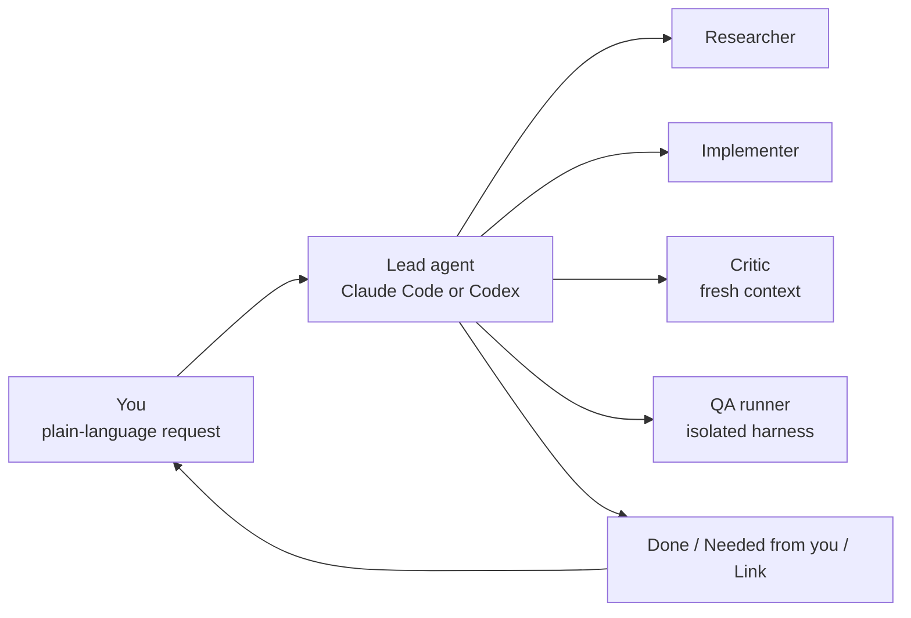

# Human-Agent Process

**Tell your AI agent what you want, in plain language. Get back finished,
tested work, delivered by a virtual team.**

Human-Agent Process turns Claude Code or Codex from a single eager assistant
into a small development team: a lead that talks to you like a team talks to
its client, plus a researcher, an implementer, an independent critic, and a QA
runner, each switched on when the work needs it. You stay the owner. You
decide goals, money, and anything that goes public. The team does the rest
and only calls something "done" when it has the evidence.

It is a plugin and a short rules block. No new app, no server, no account.

```text
You:   I want a small web app where neighbours can lend each other tools. Build it.

Agent: hap_gate: tier=3 allow_build=false critic=required

       This is a new product, so I need one round of clarification before I
       build anything. Each question has my recommendation, and "go with your
       recommendations" is a fine answer.
       1. Who uses it? One street or building, or any neighbourhood?
          Recommendation: One community per installation. ...
       2. Sign-in: Email and password, magic link, or no accounts at all?
          Recommendation: Username and password with a shared join code. ...
       ...
       Plan once you answer
       - First, the smallest end-to-end slice: join, add a tool, request it,
         approve it.
       - Then a critic reviews the plan and, after the build, the result.
       - Then tests with known-pass and known-fail cases, and I report back
         with a link to the running app.
```

That is an excerpt from a real run. The same prompt without the process made
the agent start writing code at once and finish with "I haven't tried the
borrow, approve or return steps". Full side-by-side:
[see it work](docs/start/see-it-work.md).

## What you can hand over

Anything you would brief a small team on. A few examples:

- "Add a dark-mode toggle to the settings page."
- "Our nightly export sometimes misses rows. Find out why and fix it."
- "Build me a dashboard for these three metrics, I check it on my phone."
- "Write a two-page briefing on the options for replacing our job scheduler."
- "Fix the typo in the README." (Yes, small things stay small and fast.)

The process sizes itself to the request. A typo is done and verified in one
step. A feature gets research, a plan, a critic before and after the build,
and real tests. A new product gets one bundled round of questions first, and
then no more questions until the result is ready, unless something on the
short owner list comes up (money, deletion, anything public).

## Why not just use Claude Code or Codex as they are?

Out of the box, both are excellent at writing code. What they do not bring is
a way of working. These are the gaps the process closes:

| Out of the box, an agent tends to... | With Human-Agent Process |
| --- | --- |
| start building a new product from a one-line wish | stops, asks all open questions **once**, each with a recommendation, then works through |
| ask you about details it could decide itself | decides technical details alone and reports afterwards; asks only about a short owner list: money, deletion, anything public, new products, stopping a running experiment |
| review its own work and find it fine | an **independent critic** in a fresh context reviews the plan before and the result after the build |
| call it done after the happy path worked | "done" needs a runnable check with one case that must pass and one that must fail, seen green |
| run tests however it likes | runs QA in your project's isolated harness, or reports `blocked` instead of pretending |
| answer in commit hashes and stack traces | reports in three parts: **Done**, **Needed from you**, **Link** |
| forget the places that depend on a change | the impact map lists every consumer before the build |
| let logs and caches grow until the disk is full | the growth contract: every writer declares its size limit |
| burn tokens with many parallel helpers | cost contract: one role per gate, at most two helpers, turn budgets |

For a one-line fix the difference is small, and that is intended: the
process should not slow down trivial work. The difference shows on features,
new products, and anything where a wrong "done" is expensive.

## Highlights

- **A virtual team with clear roles.** Lead, researcher, implementer, critic,
  and QA runner, each with its own scope and turn budget. The lead
  integrates; nobody reviews their own work.
- **One owner, few questions.** You get one bundled round of questions, each
  with a recommendation. "Go with your recommendations" is always a valid
  answer.
- **Reports a human can read in a minute.** Done, what is needed from you,
  and a link to look at the result. Technical evidence goes to a file or a
  short trailing section, not into the first paragraph.
- **Results you can check from your phone.** The remote-review module ends every visible result with a link that works on your phone,
  checked before it is sent.
- **Design from a real reference.** The design module starts
  user-facing work from a concrete screen, for example one generated with
  [Google Stitch](https://stitch.withgoogle.com/), and compares reference and
  result side by side on desktop and mobile. A result that looks more generic
  than its reference is not done.
- **A second opinion from another model.** The second-opinion module lets the lead consult a different model family (Codex for a Claude lead, or
  Claude for a Codex lead) where money or a statistical verdict depends on
  assumptions. One brief, one call, a fixed quota, and the lead decides. You
  provide the call; the module sets when, how often, and how the answer is
  used.
- **Memory that learns, with any store you like.** Long-term memory is an
  adapter: lessons, root causes, and guardrails are written to a store of
  your choice and searched before the next similar task. A complete
  [LightRAG adapter](examples/memory-adapter-lightrag/README.md) ships as an
  example; other stores plug in through the same
  [contract](docs/reference/memory-layer.md). No store at all also works.
- **Guardrails from real failures.** Modules for growing files,
  automation writing into shared repos, promised recurring jobs, and
  forgotten consumers. Each one exists because something broke
  ([the stories](docs/why/README.md)).

## Works with Claude Code and Codex

One shared core, two generated distributions. The rules, roles, and skills are
written once and built into a native plugin for each tool, so both share the
same rules, roles, and skills and stay in sync (CI fails on drift). The few
remaining platform differences are listed in the notes below.



| | Claude Code | Codex |
| --- | --- | --- |
| Install | plugin marketplace + rules block | plugin + `AGENTS.md` block |
| Roles | subagents | agents |
| Skills | same five skills | same five skills |
| Details | [Claude Code notes](docs/platforms/claude-code.md) | [Codex notes](docs/platforms/codex.md) |

## Quickstart

Claude Code:

```text
/plugin marketplace add ottoinator/human-agent-process
/plugin install human-agent-process@human-agent-process
```

then, from a clone of this repository, add the always-on rules:

```bash
scripts/install.sh --claude
```

Codex:

```bash
git clone https://github.com/ottoinator/human-agent-process.git
cd human-agent-process
scripts/install.sh --codex
```

Both, preview first (all modules are on by default):

```bash
scripts/install.sh --both --dry-run
```

Check that it works: ask your agent "Add a dark-mode toggle to the settings
page." The first line of the answer starts with `hap_gate:`. Upgrading from
1.x: `--migrate-from-1x`. Remove with `--uninstall`. Details:
[quickstart](docs/start/quickstart.md).

**Are you an agent** told to "install human-agent-process"? Follow
[install for agents](docs/start/install-for-agents.md). A machine index is in
[llms.txt](llms.txt).

## How it decides how much process to use

| Tier | Meaning | Minimum process |
| --- | --- | --- |
| 0 | Trivial, reversible | do it, verify it |
| 1 | Small change | one matching review or QA pass |
| 2 | Feature, user-facing | research, plan, critic before and after build, QA |
| 3 | New project or product, high risk | Tier 2 plus deep research and one owner clarification |

Every first reply starts with one machine-readable line, so you (and your
tools) can see the classification at a glance:
`hap_gate: tier=<0|1|2|3> allow_build=<true|false> critic=<required|not-required>`.

## Modules

Extra rule sets, all on by default. Each one acts only when its situation
comes up, so a module that does not apply costs nothing. Switch one off with
`--modules -name` (for example `--modules -remote-review`), or pick an exact
set with `--modules a,b`.

| Module | Acts when |
| --- | --- |
| [growth](docs/modules/growth.md) | something keeps writing (files, logs, tables) |
| [concurrency](docs/modules/concurrency.md) | automation writes into a repo or shared state |
| [routines](docs/modules/routines.md) | a plan promises recurring jobs |
| [impact-map](docs/modules/impact-map.md) | a change can leave other parts of the system stale |
| [second-opinion](docs/modules/second-opinion.md) | money or statistics depend on assumptions |
| [design-reference](docs/modules/design-reference.md) | user-facing work (screens, pages, visual reports) |
| [remote-review](docs/modules/remote-review.md) | a result can be looked at; the link works on the device you review on |

## Documentation

- Start: [see it work](docs/start/see-it-work.md), [quickstart](docs/start/quickstart.md), [install for agents](docs/start/install-for-agents.md)
- Concepts: [owner boundary](docs/concepts/owner-boundary.md), [tiers and start gate](docs/concepts/tiers-and-start-gate.md), [roles and cost](docs/concepts/roles-and-cost.md), [critic and evidence](docs/concepts/critic-and-evidence.md), [memory adapter](docs/concepts/memory-adapter.md)
- [Why the rules exist](docs/why/README.md), [decisions](docs/decisions/2026-11-04-two-platforms-one-core.md), [reference](docs/reference/terminology.md)
- [Templates](templates/README.md), [examples](examples/minimal-adoption/README.md)

## Honest status

- `automated-test`: static QA and an install smoke test run in CI for both
  distributions.
- `in-use`: the author runs it daily for software, data, and research work,
  on both platforms. That is a claim, not a proof, so it is labelled as one.
- `human-validation-missing`: no external team has reported an adoption of
  2.0 yet. You could be the first; see below.

Labels: [validation model](docs/reference/validation-model.md).

## Help make it better

The most valuable contribution right now is an **adoption report**: install
it, give it a real task, and tell us what helped and what got in the way
([issue template](.github/ISSUE_TEMPLATE/workflow_improvement.yml)). Also
welcome: sharper rules, new memory adapters, new modules, examples, and ports
to other agent tools. Start with [CONTRIBUTING.md](CONTRIBUTING.md).

## Licence

Code (scripts, tests, manifests): MIT, see [LICENSE](LICENSE). Documentation,
skills, and rule text: CC BY 4.0, see [LICENSE-DOCS.md](LICENSE-DOCS.md).
Copyright Rene Otto.
