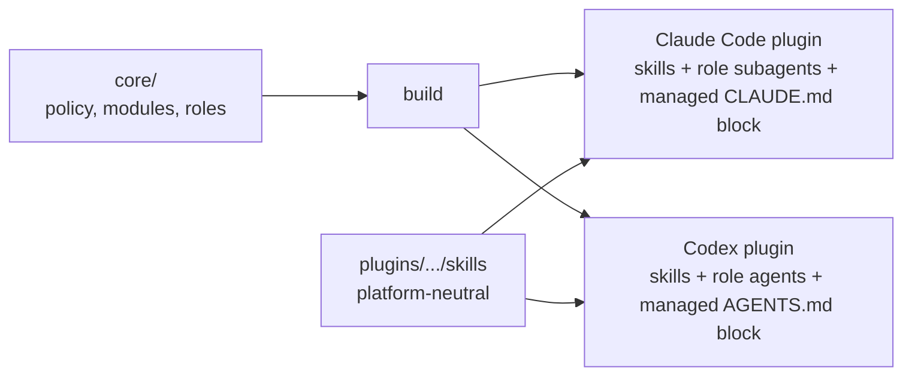

# Human-Agent Process

A working process for humans and AI agents doing real work together: tiers that scale with risk, a hard start gate, independent critics, and "done" that needs evidence.

Why: agents report success on happy paths, forget consumers, and step on each other. These rules came from those failures (see [why](docs/why/README.md)).

How: one shared core, two generated distributions, install in minutes.



## Quickstart

Claude Code:

```text
/plugin marketplace add ottoinator/human-agent-process
/plugin install human-agent-process@human-agent-process
```

then `scripts/install.sh --claude` for the always-on rules.

Codex:

```bash
scripts/install.sh --codex
```

The installer registers this checkout as a Codex plugin marketplace and
installs the plugin (`codex plugin marketplace add` plus `codex plugin add
human-agent-process@human-agent-process`); if that fails it copies the skills
instead.

Both, with all modules, preview first:

```bash
scripts/install.sh --both --modules all --dry-run
```

Upgrading from 1.x: `scripts/install.sh --migrate-from-1x`. Remove with
`--uninstall`. Details: [quickstart](docs/start/quickstart.md).

## For agents

If you are an agent and were told "install human-agent-process", follow
[docs/start/install-for-agents.md](docs/start/install-for-agents.md). Success
means your answer to a test request starts with a `hap_gate:` line. An index
for machines is in [llms.txt](llms.txt); rules for working on this repo are in
[AGENTS.md](AGENTS.md).

## The model in one screen

| Tier | Meaning | Minimum process |
| --- | --- | --- |
| 0 | Trivial, reversible | do it, verify it |
| 1 | Small change | one matching review or QA pass |
| 2 | Feature, user-facing | research, plan, critic before and after build, QA |
| 3 | New project or product, high risk | Tier 2 plus deep research and owner clarification |

The first reply to every new request starts with
`hap_gate: tier=<0|1|2|3> allow_build=<true|false> critic=<required|not-required>`.

## Modules

Optional rule sets; install with `--modules default|all|a,b`.

| Module | Default | Switch it on when |
| --- | --- | --- |
| [growth](docs/modules/growth.md) | on | something keeps writing (files, logs, tables) |
| [concurrency](docs/modules/concurrency.md) | on | automation writes into a repo or shared state |
| [routines](docs/modules/routines.md) | on | a plan promises recurring jobs |
| [impact-map](docs/modules/impact-map.md) | off | many components, easy to forget consumers |
| [second-opinion](docs/modules/second-opinion.md) | off | money or statistics depend on assumptions |
| [design-reference](docs/modules/design-reference.md) | off | user-facing work |
| [remote-review](docs/modules/remote-review.md) | off | the owner reviews on a phone |

## Documentation

- Concepts: [owner boundary](docs/concepts/owner-boundary.md), [tiers and start gate](docs/concepts/tiers-and-start-gate.md), [roles and cost](docs/concepts/roles-and-cost.md), [critic and evidence](docs/concepts/critic-and-evidence.md), [memory adapter](docs/concepts/memory-adapter.md)
- Platforms: [Claude Code](docs/platforms/claude-code.md), [Codex](docs/platforms/codex.md)
- [Why the rules exist](docs/why/README.md), [decisions](docs/decisions/2026-11-04-two-platforms-one-core.md), [reference](docs/reference/terminology.md)
- [Templates](templates/README.md), [examples](examples/minimal-adoption/README.md)

## Validation status

- `automated-test`: static QA runs in CI.
- `in-use`: applied daily by its author; unverifiable by a reader, so labelled, not proven.
- `human-validation-missing`: no external team has adopted 2.0 yet.

Labels: [validation model](docs/reference/validation-model.md).

## Licence

Code (scripts, tests, manifests): MIT, see [LICENSE](LICENSE). Documentation,
skills, and rule text: CC BY 4.0, see [LICENSE-DOCS.md](LICENSE-DOCS.md).
Copyright Rene Otto. Contributing: [CONTRIBUTING.md](CONTRIBUTING.md).
